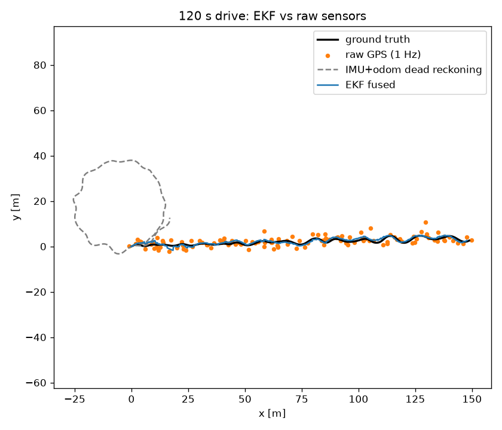

# ros2-sensor-fusion-sim

[](https://github.com/kianbqh/ros2-sensor-fusion-sim/actions/workflows/tests.yml)

I wanted to see how much a better position estimate changes a robot's ability to reach a goal. This project follows a little 2-D robot from noisy sensor readings to an EKF estimate, then uses that estimate to drive a learned controller.

The same simulation runs two ways: fast Python experiments for comparing models, and a ROS 2 loop with separate simulator, filter, policy, and metrics nodes.

```text
IMU + wheel odometry + GPS -> EKF -> learned policy -> velocity command
              ^                                          |
              +--------------- robot sim <---------------+
```

## What's running

The robot is a unicycle model with acceleration and yaw-rate controls. Its sensors are deliberately imperfect:

- IMU at 100 Hz, with gyro bias, bias drift, and measurement noise.
- Wheel speed at 50 Hz, with a scale error of up to 3%.
- GPS at 1 Hz, with 1.5 m position noise and occasional 8 m multipath jumps.

The EKF tracks `[x, y, yaw, velocity, gyro_bias]`. IMU readings drive prediction; wheel speed and GPS provide updates. A chi-square gate rejects large GPS innovations, and the covariance update uses the Joseph form.

For control, I train a two-layer, 64-unit PyTorch MLP to copy a proportional go-to-goal controller. The demonstrations contain true-state observations and expert actions. At evaluation time, the learned policy gets either the EKF estimate or raw GPS, integrated gyro heading, and wheel speed. That lets me compare the same policy with two different state estimates.

A goal counts as reached when the robot gets within **0.75 m** and slows below **0.3 m/s**, within **40 seconds**. Goals are 8–20 m away, and evaluation uses a separate set of seeds from the demonstrations.

## Run the experiments

Use **Python 3.10+**. From a Linux or WSL shell in this directory:

```bash
python3 -m venv .venv
source .venv/bin/activate
# The experiments use the CPU version of PyTorch.
python -m pip install torch --index-url https://download.pytorch.org/whl/cpu
python -m pip install -r requirements.txt
bash scripts/run_all.sh
```

The script runs 50 fusion trials with and without GPS gating, trains on 200 expert demonstrations, evaluates 200 held-out goals per controller/observation combination, tests the newly trained model, and draws the trajectory plot. The training seed defaults to 0.

On Windows, after setting up the environment in WSL:

```powershell
.\scripts\run_all.ps1 -Distribution Ubuntu
```

Replace `Ubuntu` with your installed distribution name. The project drive should be mounted under `/mnt/<drive>`.

Each step also runs on its own:

```bash
python -m fusion_core.evaluate_fusion --episodes 50 --duration 120
python -m fusion_core.imitation --demos 200 --eval 200 --seed 0
python -m pytest -q
python -m fusion_core.plot
```

The policy is saved as both `models/bc_policy.pt` and `models/bc_policy.npz`. The ROS node uses the NumPy export, so it can run the policy without importing PyTorch. A test checks that both implementations produce the same actions.

## Run the ROS 2 loop

With Docker running:

```bash
docker pull ros:humble-ros-base
bash scripts/run_ros2_docker.sh 180
```

From PowerShell with Docker Desktop running, use `./scripts/run_ros2.ps1 -Seconds 180`.

This builds the ROS package in the official Humble image and runs the nodes for 180 seconds. The simulator publishes the sensor topics, the EKF publishes `/odometry/filtered`, and the policy publishes `/cmd_vel` at 20 Hz. A metrics node records errors, topic rates, and completed goals in `results/ros2_metrics.json`.

The ROS run is one continuous drive: the robot keeps its filter state when it gets a new goal. The Python evaluation resets the robot and filter for each episode.

For an existing native ROS 2 Humble installation:

```bash
source /opt/ros/humble/setup.bash
cd ros2_ws
colcon build --symlink-install
source install/setup.bash
cd ..
export PYTHONPATH="$PWD:${PYTHONPATH:-}"
ros2 launch sensor_fusion_sim sim.launch.py \
  model_path:="$PWD/models/bc_policy.npz" \
  metrics_out:="$PWD/results/ros2_metrics.json"
```

In another sourced shell, `ros2 topic hz /odometry/filtered` shows the filter rate, and `ros2 topic echo /goal_result` shows goal outcomes.

## Results

These measurements were made locally on October 31, 2026, in WSL 2 on an Intel Core i7-12700KF. Python experiments used Python 3.12.3, NumPy 2.5.4, and PyTorch 2.15.0 on the CPU with four Torch threads. The training seed was 0.

### State estimation

Mean episode position RMSE over **50 independent 120-second drives**:

| Estimate | Position RMSE |
| --- | ---: |
| Raw GPS, held between fixes | 2.660 m |
| Dead reckoning | 51.841 m |
| EKF without GPS gating | 1.026 m |
| EKF with GPS gating | **0.979 m** |

The gated EKF reduced position RMSE by **63.2%** relative to held GPS. Its heading RMSE was 4.97°, and it rejected 5.37% of GPS fixes. At GPS fix instants alone, raw GPS RMSE was 2.563 m and gated EKF RMSE was 0.954 m.

### Goal reaching

The behavior-cloned policy used **44,440 transitions** from 200 demonstrations, with a training action MSE of 0.000061. Each row below evaluates **200 held-out goals**:

| Controller | State observation | Goals reached | Mean time for successful goals |
| --- | --- | ---: | ---: |
| Proportional expert | Ground truth | 200/200 (100%) | 11.20 s |
| Proportional expert | EKF | 198/200 (99%) | 14.08 s |
| Proportional expert | Raw sensors | 122/200 (61%) | 19.78 s |
| Behavior-cloned policy | EKF | **197/200 (98.5%)** | 16.30 s |
| Behavior-cloned policy | Raw sensors | 165/200 (82.5%) | 17.90 s |

With the same learned policy, replacing raw observations with the EKF estimate improved goal success by **16 percentage points**. The time column averages successful episodes only; each episode has a 40-second limit.

### ROS 2 continuous run

The 180-second ROS launch recorded **175.05 seconds** of live metrics after node startup, with **1,738** position-error samples. The robot reached **4 goals** and timed out on **2**. Its fused position RMSE was **0.905 m**, compared with **2.894 m** for held GPS, a **68.7%** reduction in this drive.

| Topic | Target rate (Hz) | Measured rate (Hz) |
| --- | ---: | ---: |
| `/imu/data` | 100 | 99.55 |
| `/wheel/odometry` | 50 | 49.77 |
| `/gps/fix_local` | 1 | 0.99 |
| `/odometry/filtered` | 100 | 99.54 |
| `/cmd_vel` | 20 | 19.98 |

The container ran ROS 2 Humble with Python 3.10.12 and NumPy 1.21.5, using the freshly trained NumPy model. [The local run record](results/VALIDATION.md) includes the image digest, environment, model hashes, and checks; all **11 Python tests passed**.



The full measurements are in [fusion_metrics.json](results/fusion_metrics.json), [policy_metrics.json](results/policy_metrics.json), and [ros2_metrics.json](results/ros2_metrics.json).

## Around the repo

```text
fusion_core/       Simulator, EKF, Gymnasium environment, training, and evaluation
ros2_ws/src/       ROS 2 nodes and launch file
models/            Trained PyTorch weights and NumPy export
results/           Metrics and the trajectory figure
scripts/           Python and ROS 2 run commands
tests/             Filter math, gating, Gymnasium checks, policy export, and goal reaching
```

GitHub Actions runs the Python tests and a 30-second ROS 2 loop on each push and pull request.
