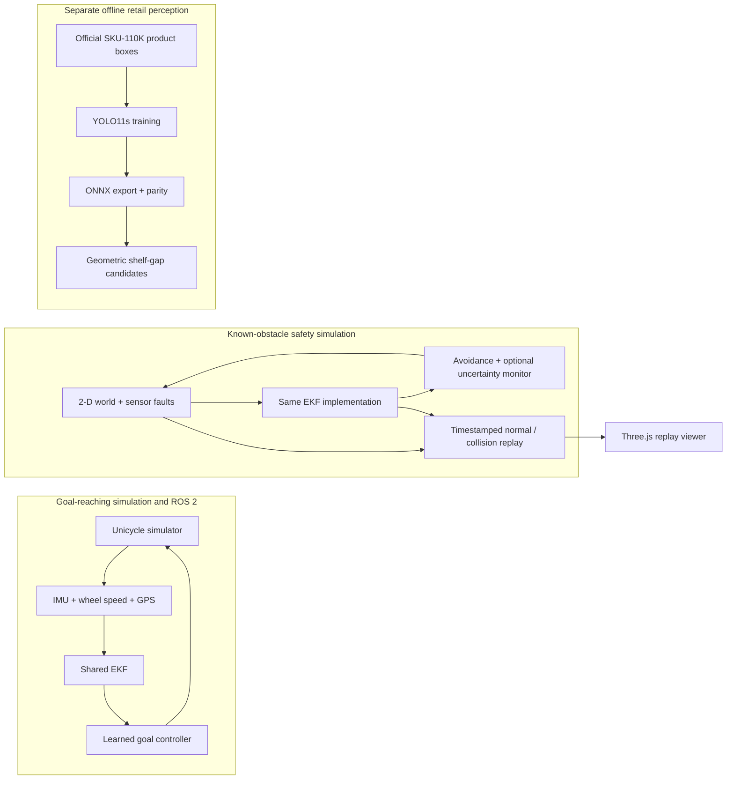

# Autonomy stack

[](https://github.com/kianbqh/autonomy-stack/actions/workflows/tests.yml)

I use this project to follow localization error through to a robot's decisions: fuse noisy sensors, drive toward goals, inject faults near known obstacles, and replay the resulting trajectories. A separate shelf-perception module trains and exports a product detector on SKU-110K.

The closed loops are **2-D simulations**. No hardware run is included. The safety controller uses known synthetic obstacles; the retail detector is an offline experiment and is **not connected to either control loop**.



## Open the integrated replay

Use Python 3.12 and Node 24.15 or newer. From the repository root:

```bash
python3 -m venv .venv
source .venv/bin/activate
python -m pip install torch --index-url https://download.pytorch.org/whl/cpu
python -m pip install -r requirements.txt pandas pillow pyarrow
bash scripts/run_stack.sh
```

Open `http://127.0.0.1:5176`. The command reruns two recorded safety cases, checks them against the original matrix, exports their state/fault traces and starts the viewer. Choose the successful normal-GPS episode or the GPS-bias collision. Playback, scrubbing, layer controls and the terminal fault/clearance display all use those exports. The 120-second fusion drive is also available.


## Measured results

| Component | Result | Evidence |
|---|---|---|
| Fusion, 50 × 120 s drives | Gated EKF position RMSE 0.979 m, held GPS 2.660 m: 63.2% lower | [Fusion metrics](results/fusion_metrics.json) |
| Learned controller, 200 held-out goals | 197/200 reached with EKF observations; 165/200 with raw observations | [Policy metrics](results/policy_metrics.json) |
| Actual ROS 2 loop | 180 s launch, 175.05 s recorded metrics; fused RMSE 0.905 m vs held GPS 2.894 m | [ROS metrics](results/ros2_metrics.json) |
| Safety matrix, 3,000 simulated episodes | Gated EKF 178/600 collisions; uncertainty monitor 61/600, with more timeouts | [Safety report](safety/results/safety_report.md) |
| Native Windows RTX 3080 rendering | 10k / 100k / 1M points: 535.30 / 572.39 / 433.20 FPS | [Every frame interval and renderer](viz/results/native-gpu/bench.json) |
| Full SKU-110K detector | Full official split prepared; 100-epoch YOLO11s training running | [Dataset provenance](perception/results/sku110k_full_provenance.json) |

Fusion, control, ROS and the full safety matrix were measured locally on 31 October 2026. The integration reruns the two exported safety cases and verifies their outcomes, duration, minimum clearance and localization RMSE against those saved matrix rows. [Replay checks and hashes](results/replay_integration.json).

The hardware rendering run used native Windows Chromium 156, NVIDIA driver 621.01 and actual RTX 3080 / ANGLE D3D11. It measured three-second windows at 1280×720 after 31 warmup intervals, synchronizing each GPU frame with `readPixels`. The safety scene has 12 draw calls. These are not a single-factor speedup comparison with the older fusion-only SwiftShader scene. [Rendering protocol and interactions](viz/README.md).

## Modules and data

- [`fusion_core/` and ROS 2](docs/fusion.md): noisy synthetic IMU, odometry and GPS; EKF, learned policy, Python experiments and the existing 180-second ROS runner. `bash scripts/run_ros2_docker.sh 180` runs the separate ROS nodes in the official Humble image.
- [`safety/`](safety/README.md): 30 fault/noise cells, five estimators and 20 seeds, with known circular obstacles. Exports normal and collision cases using the shared simulator/filter rather than a copied implementation.
- [`viz/`](viz/README.md): actual safety replay loader, truth/estimate/covariance/fault/outcome inspection and a procedural point-cloud stress scene. The cloud is not sensor data.
- [`perception/`](perception/README.md): official retail photographs and product-box labels. Its box-spacing heuristic produces gap candidates; the dataset does not label gaps or robot obstacles.

## Checks

```bash
PYTHONPATH=.:safety:perception python -m pytest --capture=sys -q tests safety/tests perception/tests
(cd viz && npm ci && npm run typecheck && npm test && npm run build)
```

One root workflow runs fusion/policy/safety/perception tests, an actual 30-second ROS 2 loop, and viewer/browser correctness. CI browser rendering is explicitly labeled SwiftShader software; the hardware table comes from the local NVIDIA run. Large datasets, training checkpoints and dependency caches stay outside Git.

The source repositories were merged with unsquashed subtrees. Their original commits remain ancestors; [history provenance](results/source_history.json) records the source HEADs, actual import commands and ancestry checks.
