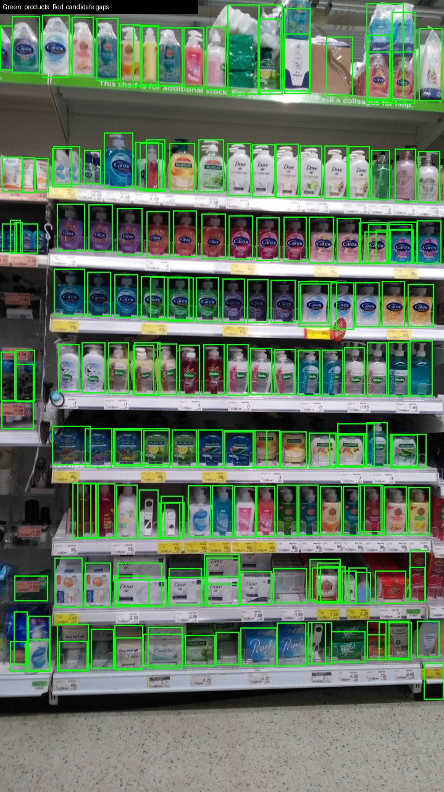
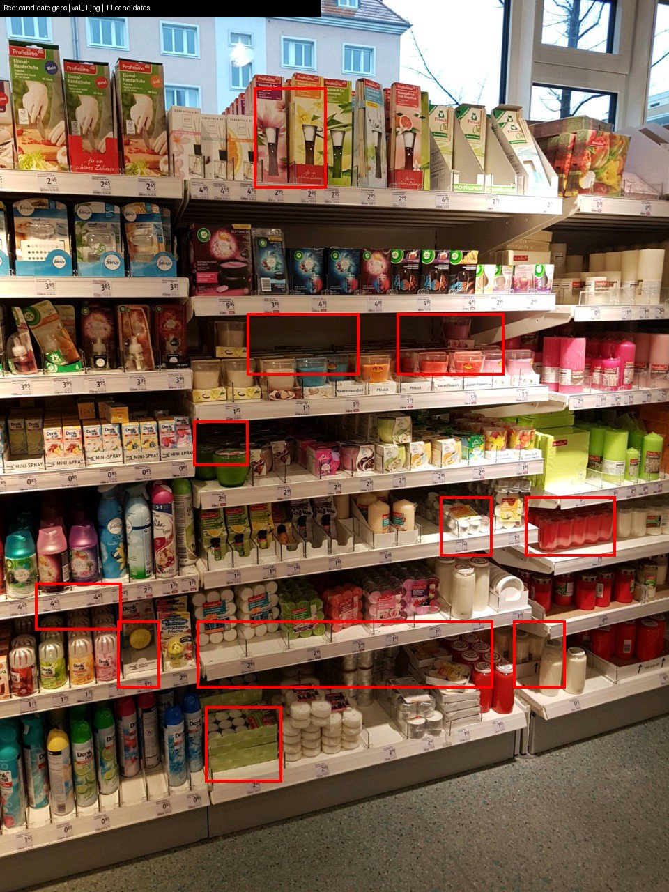

# retail-shelf-vision

I use detected product boxes to group shelf rows and mark unusually wide spaces between neighboring facings. This project connects that spacing rule to a YOLO11n detector: convert SKU-110K annotations, fine-tune on a small subset, export to ONNX, and inspect the resulting boxes and gap candidates.

The detector has one product class. The gap stage uses geometry rather than SKU identities: rows are grouped by vertical overlap, then spaces wider than 1.5 times the row's median product width become candidates.

## Run

```bash
python3 -m venv .venv
. .venv/bin/activate
python -m pip install -r requirements.txt
./scripts/run_all.sh
```

The default pipeline runs five tests, prepares 48 training and 16 validation images, trains YOLO11n for 20 epochs, exports ONNX, benchmarks both CPU runtimes, and renders examples. Dependencies use the [official headless Ultralytics package](https://github.com/ultralytics/ultralytics/blob/main/docs/en/quickstart.md), so OpenCV display libraries are unnecessary.

Downloads go into `data/parquet/`; conversion clips boxes, normalizes YOLO labels, and limits the longest image side to 1,280 pixels. `N_TRAIN` and `N_VAL` change the subset sizes. Local dataset paths resolve from the configuration file, independently of Ultralytics' global dataset directory.

## Local CPU run

Measured October 31, 2026 on an Intel Core i7-12700KF with Ubuntu 24.04 under WSL2, PyTorch 2.15.0+cu132, Ultralytics 8.4.196, and ONNX Runtime 1.31.1.

Training used the COCO-pretrained YOLO11n, 512-pixel input, batch 4, two data workers, one warmup epoch, and seed 0 with deterministic training enabled. The subset contains 7,410 training boxes and 2,321 validation boxes. All five tests passed, and all 20 epochs are recorded in [training_epochs.csv](results/training_epochs.csv).

| Best model, 16 validation images | mAP50 | mAP50–95 | Precision | Recall |
|---|---:|---:|---:|---:|
| YOLO11n | 0.6388 | 0.3056 | 0.6894 | 0.5967 |

The training call took 135.0 seconds, including per-epoch validation and finalization. The table comes from a subsequent validation of `best.pt` with `max_det=1000`. Parameters and results are in [train_smoke.json](results/train_smoke.json).

### Inference

Batch 1, FP32, 512×512 input. Raw forward timing uses two intra-op threads for both runtimes, five warmup calls, then 50 timed calls on the same seed-0 input. PyTorch runs the eager evaluation model; ONNX Runtime runs the simplified exported graph. Preprocessing and NMS are outside these forward timings.

| CPU path | p50 | p95 |
|---|---:|---:|
| PyTorch forward | 38.6 ms | 42.8 ms |
| ONNX Runtime forward | 22.6 ms | 23.5 ms |
| Ultralytics ONNX call, eight validation images | 31.9 ms | 697.8 ms |

ONNX Runtime's forward p50 was 1.70× faster, and the exported model is 10.6 MB. Its output matched PyTorch with maximum absolute difference `7.32e-4` (`atol=rtol=1e-3`, output shape `1×5×5376`).

The eight-image calls include image loading, preprocessing, inference and NMS, with confidence 0.25 and `max_det=1000`. They use the first eight sorted validation filenames. The first call took 1,055.4 ms and includes session initialization and warmup; it is included in the reported percentiles. This wrapper uses ONNX Runtime's default intra/inter-op settings, recorded as `0/0`, and two PyTorch threads. Gap calculation and drawing happen after the timer stops.

Across those images, the detector returned 1,426 boxes, averaging 178.2 per image, and the spacing rule flagged 33 gap candidates. These are box-spacing candidates; SKU-110K supplies product-box labels, so the gap count is a descriptive output. Raw timings, output parity, per-image candidates and model hashes are in [onnx_bench.json](results/onnx_bench.json).

## Examples

<p>


</p>

Left: `val_0`, with 189 product boxes and zero gap candidates. Right: `val_1`, with 11 candidates, selected as the image with the most candidates among the eight measured images. The right view is rendered from the saved candidate coordinates without another inference pass.

## Data and code

The data comes from [SKU-110K on Hugging Face](https://huggingface.co/datasets/finedet/sku110k), the finedet mirror of Goldman et al.'s CVPR 2019 dataset. The mirror lists CC BY-NC 2.0. The example images above are annotated derivatives from that dataset. [dataset_provenance.json](results/dataset_provenance.json) records the exact revision, shard hashes and pretrained-model source; raw data and model files stay outside Git.

- `shelfvision/convert.py`: Parquet-to-YOLO conversion, clipping and corrupt-image handling.
- `shelfvision/gaps.py`: row grouping and spacing candidates.
- `scripts/train.py`: seeded training and best-model validation.
- `scripts/export_bench.py`: ONNX export, numerical comparison, latency samples and detections.
- `scripts/render_gap_example.py`: visualization from saved candidates.
- `tests/`: five converter and geometry checks, also run by CI.
