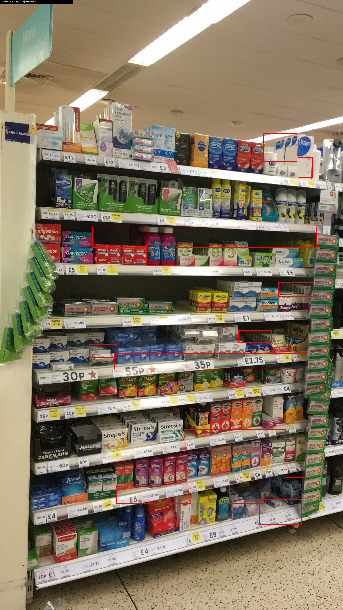

# Retail perception

I group detected product boxes into shelf rows and mark unusually wide spaces between neighboring facings. The detector is trained on real retail photographs from the full official SKU-110K release; its gap stage uses box geometry rather than SKU identities.

This module runs offline. It does not feed the robot's EKF or obstacle controller. SKU-110K labels products, not empty shelf spaces or navigation obstacles, so the red regions are geometric gap candidates.

## Full dataset and training

The official archive comes from the authors' [SKU-110K repository](https://github.com/eg4000/SKU110K_CVPR19), using the fixed archive URL also distributed in Ultralytics' dataset configuration. The authors state academic and non-commercial use. Raw photographs and model weights are kept outside Git.

The downloaded archive is 12,196,152,718 bytes, SHA-256 `fd40deee21044af97804d6583e62d43f7b317c46c70153a5fb427bd26438c226`. The converter preserves all official splits and full-size images:

| Split | Listed images | Annotation boxes |
|---|---:|---:|
| Train | 8,219 | 1,208,482 |
| Validation | 588 | 90,968 |
| Test | 2,936 | 431,546 |

The test split is prepared but is not used for model selection or the validation metrics. Conversion creates single-class normalized YOLO boxes from the official CSV dimensions, with five decimals, without image resizing or sample selection. Missing files and questionable boxes were both zero. [Archive, split and conversion provenance](results/sku110k_full_provenance.json).

Ultralytics verification accepted **8,216 training images / 1,207,996 boxes** and all **588 validation images / 90,968 boxes**. It rejected three truncated training JPEGs (`train_4222`, `train_882`, `train_924`, containing 483 labels), removed three duplicate labels, and automatically restored/re-saved 494 training and 33 validation JPEGs at their original dimensions. The downloaded archive remains unchanged. [Exact rejection reasons and loader counts](results/dataset_verification.json).

The full local run completed with COCO-pretrained YOLO11s, 640-pixel training input, 100 epochs, train batch 8, eight training workers, seed 0, the deterministic flag and three warmup epochs. The per-epoch validation loader used batch 16 and 16 workers. Training ran on a 12 GB RTX 3080 under Ubuntu 24.04 / WSL2, Ultralytics 8.4.196 and PyTorch 2.15.0+cu132. The primary pretrained model SHA-256 is `85a76fe86dd8afe384648546b56a7a78580c7cb7b404fc595f97969322d502d5`.

An initial batch-16 attempt reached batch 502/514 of its first epoch, then was stopped after measured dedicated/shared GPU memory pressure produced multi-minute batches. It completed no epoch or validation metric and logged no OOM. The batch-8 run starts independently from the same pretrained checkpoint for the full 100 epochs. [Attempt and resource record](results/batch16_attempt.json).

An official RAM-cache attempt during checkpoint recovery retained the library's memory gate: training cache was rejected and stayed off; per-epoch validation used RAM caching. The final standalone validation used batch 8, eight workers and cache off. The archive, accepted examples and model settings stayed the same. [Actual cache and recovery record](results/training_cache_transition.json).

## Results

The selected best checkpoint was validated on all 588 official validation images and 90,968 product boxes after the 100 training epochs:

| Metric | Result |
|---|---:|
| Precision | 0.9111 |
| Recall | 0.8739 |
| mAP50 | 0.9281 |
| mAP50–95 | 0.5782 |

[Training and final validation](results/train_full_3080.json) includes each completed epoch, the separate final validation, per-class precision/recall and the AP-by-IoU array. [Native training CSV](results/full_training_epochs.csv) preserves all 100 rows. Checkpoint recovery and coordinated pauses remain in the timing records; epoch callback time, individual invocation time and the overall wall span have separate meanings in the [artifact manifest](results/model_artifacts.json).

The 37,928,330-byte ONNX graph passed raw-output comparison with PyTorch on one seed-0 synthetic float32 tensor at shape `1×3×640×640`. All `1×5×8400` output values passed `rtol=atol=0.001`; maximum absolute error was `0.000152587890625`.

Raw CPU forward timings used an Intel Core i7-12700KF under WSL2, batch 1, four threads, five warmup calls and 50 timed calls per backend:

| Backend | p50 | p95 |
|---|---:|---:|
| PyTorch eager | 77.4 ms | 83.6 ms |
| ONNX Runtime | 52.5 ms | 53.9 ms |

A separate ONNX end-to-end pass over 20 official validation images measured 66.2 ms p50 / 137.2 ms p95, with 153.8 mean product detections per image and 93 geometric gap candidates. That pass uses Ultralytics' ONNX session defaults (ORT intra/inter-op settings `0/0`, Torch threads 2), rather than the raw benchmark's four-thread setup. Its timer includes loading, preprocessing, inference and NMS; the first image includes session initialization. Gap grouping and drawing are outside the timer. These 20 images are ONNX observations; the raw-output parity input is the single synthetic tensor. [All timing samples and per-image output](results/onnx_bench_full.json).



Red boxes mark candidates from detected-product spacing, not annotated empty-space ground truth. This example is `val_106.jpg`, the image with the most candidates among the 20 measured images; rendering reused those detections. A [separate example from val_0.jpg](results/example_detections.jpg) shows detected products in green alongside candidate gaps in red.

### Download the model

[yolo11s-sku110k-full.zip](https://github.com/kianbqh/autonomy-stack/releases/download/sku110k-yolo11s-v1/yolo11s-sku110k-full.zip) contains `best.pt`, `best.onnx`, the artifact manifest and the installed Ultralytics license/attribution. It is 50,198,498 bytes, SHA-256 `751299d0795f364748341f72592eb30aec30b124551fe22bd63322364f0df353`. [Package record](results/model_release.json) and [model hashes, provenance and original metadata](results/model_artifacts.json).

## Run

From the repository root, create an environment and install `perception/requirements.txt`, then download the [official fixed archive](https://trax-geometry.s3.amazonaws.com/cvpr_challenge/SKU110K_fixed.tar.gz) into a separate cache/data directory:

```bash
(cd perception && \
python scripts/prepare_full.py --archive /path/to/SKU110K_fixed.tar.gz \
  --root /path/to/datasets \
  --out results/sku110k_full_provenance.json && \
python scripts/train.py --model yolo11s.pt --data /path/to/datasets/SKU110K_fixed/data.yaml \
  --device 0 --epochs 100 --imgsz 640 --batch 8 --workers 8 --seed 0 \
  --name sku110k_full_yolo11s --project /path/to/runs --out results/train_full_3080.json && \
python scripts/export_bench.py --weights /path/to/runs/sku110k_full_yolo11s/weights/best.pt \
  --imgsz 640 --image-list /path/to/datasets/SKU110K_fixed/val.txt --out results/onnx_bench_full.json)
```

The preparation script safely resumes extraction by reusing complete files, then atomically rewrites labels so repeated conversion does not append duplicates. It hashes the supplied archive; `--download-record` can reuse an existing downloader's URL, size and checksum record. The training script saves exact arguments, actual loader counts, each epoch's elapsed time and metrics, the full raw CSV, best-weight hash and a separate validation of the best model with `max_det=1000`.

To recover an interrupted run, repeat its training command with `--resume /path/to/runs/<same-name>/weights/last.pt`, keeping the same name, project, output and saved progress JSON. This restores optimizer/EMA state and retains completed epochs. The training timer sums completed epoch wall-time windows, including validation, checkpoint work and any logged pause within an epoch; initialization, interruption gaps and discarded partial epochs are separate. The full-data run's [checkpoint recovery record](results/training_recovery.json) preserves its actual interruption and retained checkpoint.

ONNX export compares raw outputs against PyTorch on the same seed-0 input. Raw CPU forward measurements use five warmup calls followed by 50 timed calls, batch 1 and four threads. The separate validation-image calls include image loading, preprocessing, inference and NMS, including first-call initialization; gap grouping and drawing are outside that timer. The script records all timings, model hashes and per-image detections/candidates.

## Code and checks

- `scripts/prepare_full.py`: official CSV conversion and safe private archive extraction.
- `scripts/train.py`: fixed-seed training, actual data counts, epoch timings and best validation.
- `scripts/export_bench.py`: ONNX export, parity, timing samples and candidate rendering.
- `shelfvision/gaps.py`: vertical-overlap row grouping and spaces wider than 1.5 times the row's median product width.
- `shelfvision/convert.py`: optional Parquet-mirror converter, retained with its five unit checks.

From the repository root, `PYTHONPATH=.:perception python -m pytest --capture=sys -q perception/tests` runs the converter and gap-geometry tests. The root workflow includes these checks; full training is a local GPU run.
