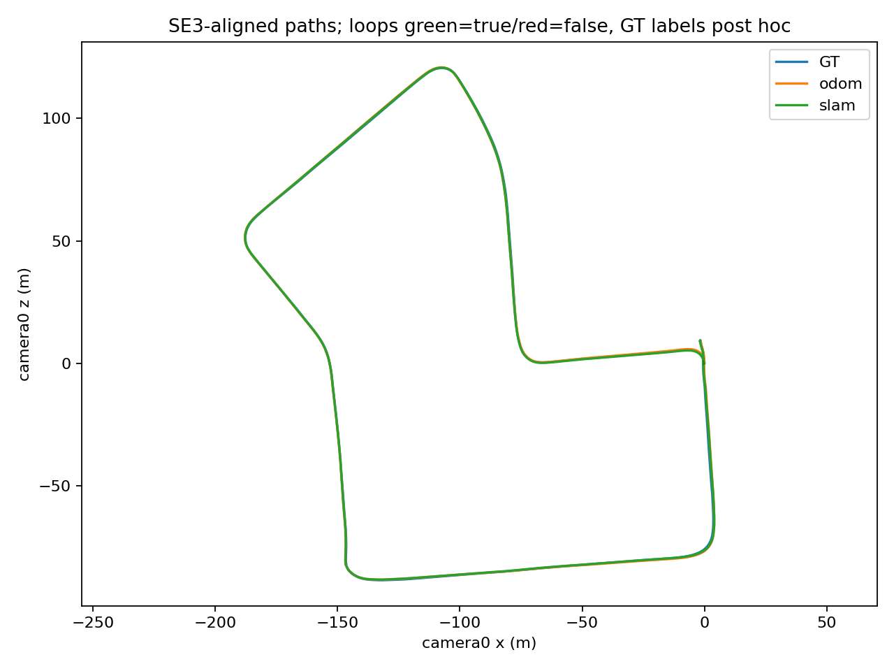
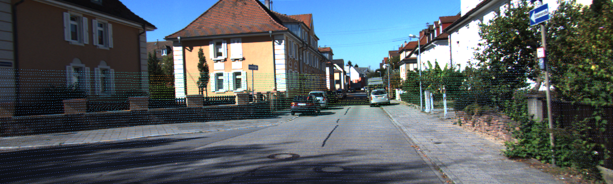

# Offline LiDAR odometry and loop closure

I use this module to follow how scan-registration error changes a recorded trajectory, then measure what geometrically verified loop closures add. The front end is C++17 point-to-plane ICP with Eigen and nanoflann; GTSAM 4.2 optimizes the pose graph. The work uses KITTI odometry scans and a separate camera–LiDAR consistency diagnostic.

The native build passes **15 C++ tests** and actual positive/negative synthetic fixtures. All [six CI jobs at `75bb06e`](https://github.com/kianbqh/autonomy-stack/actions/runs/41585516271) pass. Sequence 07 now has complete 1,101-frame odometry and graph tracks. Both tracks pass the independent evo and official KITTI comparisons. The camera–LiDAR diagnostic and recorded replay checks have also completed.

```mermaid
flowchart LR
  scans[KITTI scans + timestamps] --> filter[Range / voxel filtering]
  filter --> icp[Point-to-plane ICP]
  icp --> odom[Odometry + bounded local map]
  odom --> candidates[Descriptor loop proposals]
  candidates --> verify[Reciprocal ICP verification]
  verify --> graph[GTSAM pose graph]
  graph --> tracks[Camera0 SE3 tracks]
  tracks --> metrics[evo / KITTI metrics]
  truth[Ground truth] --> metrics
  tracks --> replay[3-D recorded replay]
  calibration[Calibration + selected images] --> diagnostic[Projection / perturbation diagnostic]
  scans --> diagnostic
```

## Results

The complete sequence 07 run retains **1,101 original IDs/timestamps and valid SE3 poses** in both tracks, with 381 keyframes. Its two accepted loops are both true positives under the post-hoc GT-distance-below-4 m rule. The candidate log also contains 18 rejected true candidates; it does not define recall over every possible revisit.

| Metric | ICP odometry | Loop graph | Unit |
|---|---:|---:|---|
| ATE, SE3 without scale | 0.56306443 | 0.37027268 | m |
| One-frame translation RPE | 0.0174067442 | 0.0174025719 | m |
| One-frame rotation RPE | 0.0609375168 | 0.0609270764 | deg |
| 100 m translation RPE | 0.765795786 | 0.790350799 | m |
| 100 m rotation RPE | 0.756455196 | 0.748728228 | deg |
| Official KITTI translation | 0.688189128 | 0.681179855 | % |
| Official KITTI rotation | 0.510249857 | 0.508066856 | deg / 100 m |

**ATE improves, while 100 m translation RPE worsens.** The graph changes the global trajectory and local distance-pair errors differently. All ten saved evo error arrays pass the independent comparison; the official devkit check covers 317 valid segments. The 100 m RPE uses 881 exact original frame pairs. [Exact metrics](results/kitti07-20261103/evaluation-corrected-75bb/metrics.json), [summary and timing samples](results/kitti07-20261103/REAL_METRICS_SUMMARY.json).



Native generation is `61d485e79d8f1cd4ef5791f148c853555f4db390`; the corrected evaluator is `75bb06e7b114a2f004d0d8c44348864e728095f8`. Both tracks come from the same immutable run and runtime config `ee689925bcecd2ee7c71817e47903a2c677c7c8dd09684ef2c7e5067d9d6c5da`. The published [default config](configs/seq07.json) contains those tested bytes; [the measured copy, original config and two-field diff](results/kitti07-20261103/configs/termination-precision.diff) retain their history.

The runtime stopping precision is **0.001 m translation / 0.0001 rad rotation**. A geometry-only diagnosis at frame 114 found submillimetre correspondence cycling under the former 0.0001 m / 0.00001 rad precision. The uniform stopping change is small relative to the fixed 0.4 m scan voxel. It retains the 40-iteration budget, data selection and all fitness, inlier, conditioning and loop gates; GT was used afterward for evaluation.

## Registration and mapping

Scans are little-endian float32 XYZI. Range filtering precedes a deterministic voxel-centroid filter. Voxel cells are lexicographically ordered; an over-cap cloud is uniformly sampled by ordered cell index. A scan/loop cloud has at most 35,000 points. The local target holds at most 15 recent keyframes and 100,000 downsampled map points.

PCA normals use kNN, a radius limit and a smallest-to-middle eigenvalue planarity gate. ICP rejects distant pairs, trims residuals and solves Huber-weighted point-to-plane normal equations. Six-DoF conditioning gates catch locally ambiguous geometry, including a single plane. `rmse_m` is the unweighted retained-correspondence point-to-plane fitness after convergence. Failed convergence, invalid geometry, too few inliers or failed fitness stops the attempt and saves the accepted prefix.

The initial guess is constant velocity: `X_(i-1) * (inverse(X_(i-2)) * X_(i-1))`. Keyframes trigger at 1.5 m or 10 degrees of total relative rotation. Historical descriptors, indices and graph poses have a 4,000-keyframe guard. Old loop clouds are read from the original scan files when needed.

The polar ring/sector max-height descriptor follows the Scan Context idea. Ring keys nominate five temporally eligible candidates; descriptor matching checks every sector yaw shift. Angular-support and ambiguous-yaw gates precede actual forward/reverse ICP, fitness, inlier, conditioning, convergence and reciprocal-transform checks. `loops.jsonl` retains every proposal, temporal exclusion and decision reason. Ground truth enters evaluation after the native run.

The graph anchors its first pose and uses Gaussian odometry factors and Huber loop factors with `BetweenFactor<Pose3>`. It performs one end-of-sequence Levenberg–Marquardt optimization. The front end continues to use its odometry map. Factor sigmas are declared modeling choices.

## Coordinates and original samples

Column vectors are used throughout: `T_A_B` maps B coordinates into A. Internally `X_i=T_L0_Li`, `X_0=I`; the residual is `n·(T*p-q)` and twists are `[omega,v]`. ICP centers the target at its deterministic centroid `c`, solves in that frame with a left SE(3) update, and returns `Translate(c)*T_center_source`. The Jacobian is `[transformed_p cross n,n]`. Internal rotation updates retract to SO(3) through a normalized quaternion. External initial poses still pass the original validity checks. Translation in Exp uses the SO(3) left Jacobian.

KITTI `Tr=T_rectCam0_Lidar` already includes rectification. Camera0-relative output is `Tr * X_i * inverse(Tr)`; the recorded replay normalizes GT by `inverse(GT_0)*GT_i`. Image_2 projection is **`P2 * Tr * p_L`**. The viewer applies the proper display rotation `[camera_x,-camera_y,-camera_z]` to the complete camera0 SE3 poses.

Every accepted scan keeps its original ID and timestamp. Between keyframes a,b, graph corrections are interpolated on SE(3): `C_k=X_k_optimized*inverse(X_k_odometry)`, `C_i=C_a*Exp(alpha*Log(inverse(C_a)*C_b))`, output `C_i*X_i`. Alpha uses actual `times.txt`; the final correction is held after the last keyframe. This is a correction-interpolation approximation.

## Build and evaluator

The Linux setup needs a C++17 compiler, CMake ≥3.22, Ninja, Git and Boost's serialization, system, filesystem, thread, program_options, date_time, timer, chrono and regex components. The measured local build uses GCC 13.3, CMake 4.4.4, Ninja 1.13.2 and Boost 1.83. The [source lock](dependencies.lock.json) pins the actual archives and hashes for Eigen 3.4.0, nanoflann 1.6.3, GTSAM 4.2 and GoogleTest 1.15.2. [Boost's lock](prerequisites.lock.json) records the separate prerequisite recipe.

From a clean source checkout, choose a workspace outside the repository for dependencies, data and results:

```bash
export SLAM_WORK=/path/to/slam-work
python3.12 -m venv "$SLAM_WORK/eval-venv"
export EVAL_PYTHON="$SLAM_WORK/eval-venv/bin/python"
"$EVAL_PYTHON" -m pip install --require-hashes -r slam/requirements-eval.lock.txt
python3 slam/python/fetch_locked_sources.py --lock slam/dependencies.lock.json \
  --output "$SLAM_WORK/archives"
python3 slam/python/build_native.py --lock slam/dependencies.lock.json \
  --archives-dir "$SLAM_WORK/archives" --scratch-parent "$SLAM_WORK/builds" \
  --repo-root "$PWD" --jobs 1 --cmake-policy-version-minimum 3.5
```

For a private Boost installation, add `--prerequisite-prefix /path/to/boost-prefix`; the option is repeatable. The build's own prefix comes first so GTSAM and SLAM share Eigen. CMake 4 needs the explicit GTSAM 3.5 compatibility option above. The helper compiles dependencies/library/CLI, runs CTest and records compiler, tool, source, dependency, binary and dynamic-library identities. Preserve the receipt's loader environment, including `LD_LIBRARY_PATH` for private library prefixes, for subsequent native commands. `--git /path/to/git` selects an explicit Git executable when needed.

The [evaluation lock](evaluation-environment.lock.json) and [hashed requirements](requirements-eval.lock.txt) cover the measured CPython 3.12/Linux x86_64 environment: NumPy 2.2.6, SciPy 1.15.3, OpenCV-headless 4.11.0.86, matplotlib 3.10.3, evo 1.31.0, pytest 8.3.5 and their transitives. CI's Ubuntu Boost packages are recorded separately from the local source-built Boost prefix.

## KITTI data and one-command run

KITTI odometry by Geiger et al. is distributed under [CC BY-NC-SA 3.0](https://www.cvlibs.net/datasets/kitti/eval_odometry.php). Obtain the official Velodyne, poses, calibration and color ZIPs through the provider's distribution. Keep raw scans, images, archives and large clouds outside Git.

Sequence **07 contains 1,101 scans/timestamps/poses**. The calibration diagnostic fixes image_2 frames **0, 550 and 1100**. Sequence 00 is an optional 4,541-frame extension. `import_kitti.py` verifies the four archive sizes/SHA-256 values, member paths, CRCs and extracted hashes. Byte-identical repeated members are accepted. For the official calibration pair, the complete calibration ZIP supplies `Tr`; the color ZIP's P0–P3 subset must match exactly. Conflicting data fails explicitly.

Create an archive manifest with the actual four official filenames, completed `bytes`, `sha256` and local `path` fields under `archives`. Supply the exact paths from the native build receipt:

```bash
bash slam/scripts/run_kitti.sh 07 \
  --config slam/configs/seq07.json \
  --archives-manifest "$SLAM_WORK/completed-archives.json" \
  --build-receipt /path/to/native-build/build.json \
  --binary /path/to/native-build/slam-build/run_kitti_slam \
  --eval-python "$EVAL_PYTHON" \
  --output-parent "$SLAM_WORK/pipelines" \
  --official-oracle /path/to/independent/official_oracle
```

This invokes import → native run → evo/official evaluation → calibration → replay export. `--data-root /path/to/verified-extraction` revalidates and reuses an existing extraction. Each attempt has a new directory, and each downstream stage uses the exact path returned by its predecessor. Failures retain `pipeline.json`, logs and the native accepted prefix. Optional paths and environment fallbacks are listed by `bash slam/scripts/run_kitti.sh --help`. Sequence 00 requires both `--allow-sequence-00` and an explicit full-sequence config.

The official oracle is an independently built adapter with the argument/output contract in [`official_parity.py`](python/official_parity.py). Omitting it keeps the pipeline's independent-evaluation status partial. No official devkit implementation is bundled here. Every attempt records the clean Git checkpoint, source/config/input/build hashes, package and hardware identities, commands, timestamps and failures.

## Evaluation and timing

ATE aligns the original raw position arrays with no-scale SE(3) Umeyama alignment. Standard RPE uses rigid inverses (`R.T`, `-R.T*t`) on the validated pose matrices, for adjacent original frames and 100 m GT-distance pairs, without first origin-normalizing the rounded GT matrices. Distance endpoints are the first GT cumulative distance **strictly greater** than start+length. RPE uses all eligible start frames; KITTI segments use every tenth start and lengths 100–800 m.

The separate official KITTI branch retains the raw poses, general matrix inverses, float32 cumulative distances/scalar errors, double pose matrices, original start/length ordering and a serial aggregate mean. Translation is percent; rotation retains rad/m, deg/m and converted deg/100 m. ATE/RPE retain double precision. Empty pair sets have count zero and null means.

evo 1.31.0 independently checks ATE and translation/rotation RPE. The 100 m adapter expands the exact selected pairs, retains even-index adjacent errors and records ignored pair-boundary errors. Official parity compares cumulative-distance bits, segment identities/endpoints/order, per-segment errors and aggregate values. Raw commands, arrays, ZIPs and logs remain with each evaluation. Post-hoc loop labels use GT separation below 4 m after the run.

Timing receipts separate registration-only samples, I/O-inclusive frame time, final graph optimization, process CPU time and total wall time. Means and p95 use the retained samples with linear percentile interpolation. Prefix flush is included in frame-inclusive time; final diagnostic flush is included in total process wall time. Current driving attempts ran on a shared Windows/WSL host; their raw times describe that execution environment.

| Shared-host timing scope | Mean | p95 |
|---|---:|---:|
| Registration only, 1,100 non-origin frames | 10.690 ms | 20.075 ms |
| I/O-inclusive frame, same samples | 33.353 ms | 77.515 ms |

Final graph optimization took 9.219 ms. Native process wall time was 36.756231 s and process CPU time 36.743934 s. These are one shared Windows/WSL-host execution with no warmups or repeated passes; the [raw timing scope and samples](results/kitti07-20261103/REAL_METRICS_SUMMARY.json) are retained.

## Camera–LiDAR diagnostic

Projection uses positive-depth/range/image masks and a nearest-depth z buffer. LiDAR depth-discontinuity pixels are scored against a fixed Canny-edge distance transform with capped/normalized distances, support gates and an in-image coverage penalty. Sparse holes alone are excluded from depth discontinuities. Fixed left perturbations in rectified camera0 axes cover ±2 degrees per rotation and ±0.1 m per translation.

The completed diagnostic uses frames 0, 550 and 1100 at `61d485e` with original config `51a4f2fa286f351b720bb3436054873a53edbfbe1a607664306694b43c458292`; its calibration fields are identical to those in the full-run config. The supplied-transform mean composite score is **0.5733597079912821**, with lower values preferred. The best sampled offsets are zero for rx, ry, rz, tx and ty, and **+0.025 m for tz**.

The output retains per-frame/offset scores, coverage/support, curve shapes, frame-bootstrap intervals and depth-colored overlays with KITTI attribution. Three recorded frames and one-axis sweeps support a sensor-consistency observation. They do not establish recovered extrinsics.



[Frame 0](results/kitti07-20261103/calibration-original51a4/overlay-000000.png), [frame 1100](results/kitti07-20261103/calibration-original51a4/overlay-001100.png), [axis-sweep plot](results/kitti07-20261103/calibration-original51a4/score-shape.png) and [all scores/support/bootstrap intervals](results/kitti07-20261103/calibration-original51a4/calibration.json). These overlays derive from KITTI odometry by Geiger et al., CC BY-NC-SA 3.0. The +0.025 m sampled tz optimum was not applied to the input calibration.

## Replay and retained failed attempts

[`kitti-slam-replay/v1`](../viz/src/slam/replay.ts) retains full camera0 SE3, original timestamps, separate odometry/optimized/GT tracks and every actual loop reason. Export a terminal attempt while using its recorded source checkpoint:

```bash
"$EVAL_PYTHON" slam/python/export_replay.py --run /path/to/exact-attempt \
  --truth /path/to/verified-data/dataset/poses/07.txt \
  --repo-root "$PWD" --output-parent "$SLAM_WORK/replays"
```

Serve the exact derived JSON under a new viewer data path and open [`?view=slam&replay=<same-origin-json-url>`](../viz/README.md#recorded-slam-entry). Complete runs can show all three tracks; failed runs show their accepted odometry/GT prefix, unavailable optimization and an unknown failed-frame pose. The red marker denotes the last accepted location. Replay exports contain trajectories rather than a procedural replacement point cloud.

Three earlier driving failures remain attached to their original attempts: [frame 27](results/kitti07-20261103/failures/ca9-frame27/failure.json) from internal rotation drift, [frame 50](results/kitti07-20261103/failures/c925-frame50/failure.json) at the iteration gate, and [frame 114](results/kitti07-20261103/failures/61d-strict-frame114/failure.json) under the strict stopping precision. The fixes add normalized internal SO(3) retraction, tested unscaled two-cycle handling and the documented uniform stopping precision. These attempts retain their accepted prefixes and have no invented optimized or failed-frame pose.

The [browser checks](results/kitti07-20261103/browser/README.md) pass the full1101 replay, original real27 prefix and explicitly synthetic2 degeneracy fixture. The focused camera regression uses viewer `a5139856`, the same native61d export and headless SwiftShader. Actual GL matrices put all 3,303 track points inside the clip volume at desktop and narrow viewport sizes. [Desktop capture](results/kitti07-20261103/browser/focused-fit/desktop-end.png), [narrow capture](results/kitti07-20261103/browser/focused-fit/narrow-end.png), [functional receipt](results/kitti07-20261103/browser/functional/browser-acceptance.json) and [focused receipt](results/kitti07-20261103/browser/focused-fit/fit-regression.json) retain their separate source identities.

The first partial evaluator output is also retained. The corrected75bb evaluator processes the same native pose bytes with the standard ATE/RPE definitions and the separate official scalar branch described above. The [final result summary](results/kitti07-20261103/FINAL_RESULT_SUMMARY.md) identifies the superseding result.


## Checks and scope

The [native CI job](https://github.com/kianbqh/autonomy-stack/actions/runs/41585516271) compiles the locked sources, executes all 15 C++ tests and checks actual positive/negative CLI fixtures. Tests cover known SE3, noise/overlap/outliers, world-origin conditioning, plane degeneracy, finite-difference updates, negative-yaw/pi boundaries, long-sequence SO(3) retraction, unscaled two-cycle convergence, descriptor sign, an ICP-verified GTSAM toy loop, timestamp correction, binary I/O and the rectified calibration chain. Python tests cover alignment/scale errors, exact distance pairs, evo/devkit adapters, projection occlusion, imports and replay contracts.

```bash
"$EVAL_PYTHON" -m pytest --capture=sys -q slam/tests
ctest --test-dir /path/to/native-build/slam-build --output-on-failure
```

This is offline LiDAR-only mapping without IMU fusion, deskewing or dynamic-object segmentation. Repetitive structure and local ICP minima can still defeat registration or loop verification. Correction interpolation and fixed factor sigmas are modeling approximations. The existing 2-D simulator's synchronous Gaussian noise, bias walk and GPS-outlier tests remain a separate experiment.

References: [GTSAM 4.2](https://github.com/borglab/gtsam/releases/tag/4.2), [nanoflann 1.6.3](https://github.com/jlblancoc/nanoflann/releases/tag/v1.6.3), [Scan Context authors](https://github.com/gisbi-kim/scancontext_tro), [KITTI conventions/evaluation](https://www.cvlibs.net/datasets/kitti/eval_odometry.php), [KITTI-linked pykitti loader](https://github.com/utiasSTARS/pykitti/blob/master/pykitti/odometry.py), [evo 1.31.0](https://github.com/MichaelGrupp/evo/releases/tag/v1.31.0). Descriptor/ICP code here is independently written; libraries retain their own licenses.
