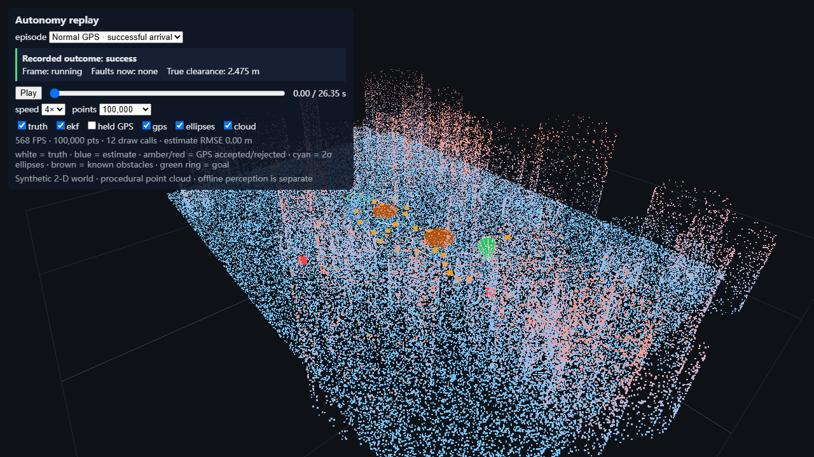
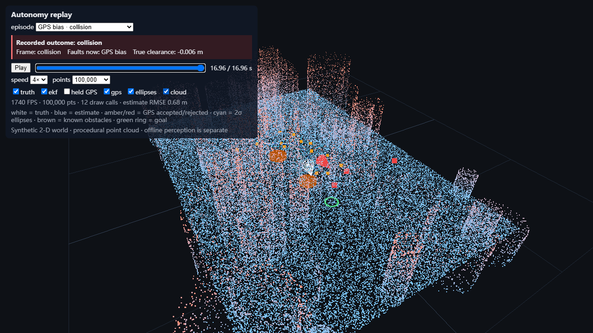

# Autonomy replay viewer

I use this viewer to inspect where an estimated trajectory separates from the true one, then look at the sensor faults and obstacle clearance at that moment. The default recordings come from the safety runner in this repository, rather than an unrelated visualization fixture.

The normal episode reaches its goal; the GPS-bias episode collides. The selector loads their actual exported poses, covariance, known obstacles, goal, injected-fault flags and outcomes. The timeline can pause, scrub and jump to the exact terminal sample, including collisions between controller ticks. The grey baseline holds GPS between fixes. A separate 120-second fusion drive remains available and labels its grey path as dead reckoning.

The world and motion are synthetic 2-D simulation rendered in Three.js. The point cloud is procedural stress geometry (seed 7), not LiDAR. Retail perception runs offline and does not supply obstacles to this controller.



## Run

From the repository root, `bash scripts/run_stack.sh` regenerates the two safety recordings and starts the application at `http://127.0.0.1:5176`. See the root README for Python and Node setup.

From this directory:

```bash
npm ci
npm run typecheck
npm test
npm run build
npm run dev
```

There are 16 unit tests covering geometry, covariance, exported replay validation, timeline interpolation, procedural point generation and frame statistics. Browser checks exercise Play/Pause, dragging the timeline, point counts, layer visibility, normal/failure replay selection and the terminal fault/outcome/RMSE display.

## Native hardware measurements

Measured locally on 1 November 2026, Windows x64, i7-12700KF, RTX 3080 12 GB, NVIDIA driver 621.01, Node 24.22.2 and Chromium 156.0.8078.4. The actual WebGL renderer was `ANGLE (NVIDIA, NVIDIA GeForce RTX 3080 (0x0000220A) Direct3D11 vs_5_0 ps_5_0, D3D11)`.

| Procedural points | FPS | Frame p50 | Frame p95 | Frame intervals | Draw calls |
|---:|---:|---:|---:|---:|---:|
| 10,000 | 535.30 | 1.70 ms | 3.28 ms | 1,605 | 12 |
| 100,000 | 572.39 | 1.60 ms | 2.90 ms | 1,717 | 12 |
| 1,000,000 | 433.20 | 2.20 ms | 3.40 ms | 1,298 | 12 |

Each group uses the same exported normal safety episode, a 1280×720 canvas at pixel ratio 1, an orbiting camera, 31 warmup intervals and a three-second window. A one-pixel synchronous `readPixels` follows each render, so the frame intervals include completion of GPU work. FPS is 1000 divided by their arithmetic mean; percentiles interpolate at `p*(N-1)`. Vsync and Chromium's frame cap are disabled. Short runs retain normal measurement variation; the 100k group is not a separate rendering optimization.

[Raw frame intervals and hardware metadata](results/native-gpu/bench.json) include the actual episode hash/world, browser GPU information, group start/end times, source hashes and built bundle hashes. The safety scene includes two obstacles and a goal ring, giving 12 draw calls. The earlier fusion-only software scene had different geometry; these numbers are not presented as a measured hardware speedup over that scene.

The interactive HUD reports unsynchronized frame-loop frequency. Use the synchronized benchmark table for rendering performance. [Final interaction checks](results/native-ui-final/ui-smoke.json) verify that the collision frame shows GPS bias, negative true clearance and the exported localization RMSE, 0.68 m.



## Benchmark modes

`npm run bench` uses explicitly labeled headless SwiftShader for CI correctness. The root workflow runs one small window plus the interactions and uploads the software renderer artifacts; its FPS is not a local GPU result.

For a native Windows test, build first, install Playwright's matching Chromium into a G-drive browser directory, and set these PowerShell variables before `npm run bench`:

```powershell
$env:BENCH_MODE = 'native-gpu'
$env:CHROME_PATH = 'G:\autonomy-cache\browsers\chromium-1248\chrome-win64\chrome.exe'
$env:BENCH_PROFILE = 'G:\autonomy-cache\profile'
$env:BENCH_CACHE = 'G:\autonomy-cache\browser-cache'
npm run bench
```

This launches its own browser profile. It requires actual NVIDIA/D3D11 WebGL and rejects SwiftShader, WARP, llvmpipe and software renderers. `BENCH_CHECKS_ONLY=1` runs the interactions without collecting more FPS groups. Captures wait for the final GPU frame and stop the render loop before taking a screenshot.

## Data

[`public/data/replays/index.json`](public/data/replays/index.json) points to the files written by `python -m avsafety.export`. [`replay_integration.json`](../results/replay_integration.json) records the exact matrix rows, outcomes, numeric checks and hashes. The optional legacy drive is generated by the shared fusion simulator; its seed and provenance are in [`data_provenance.json`](results/data_provenance.json).
