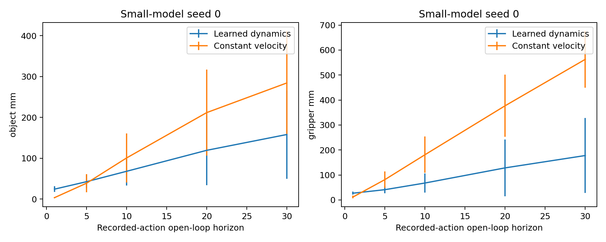

# Small learned world model and MPC

I train a small state encoder and action-conditioned latent dynamics model, then
use its physical decoder inside a bounded CEM controller. The experiment asks
whether recorded-action prediction errors explain closed-loop pushing success
relative to behavior cloning. MPC uses the known object-goal distance cost.

## Measured results

Each seed uses the same 100 held-out resets. Standard deviation is the population
standard deviation of the three trained-seed success rates.

| Method | Successes by seed, each /100 | Mean success | Population std, percentage points |
|---|---|---:|---:|
| BC | 5 / 4 / 7 | 5.33% | 1.25 |
| DR-BC | 4 / 9 / 22 | 11.67% | 7.59 |
| Learned MPC | 6 / 5 / 7 | 6.00% | 0.82 |

Learned MPC underperformed DR-BC on mean nominal success. The three world models
completed 100/100/67 epochs; validation selected epochs 98/94/57. Prediction errors
averaged over episode means, then over the three model seeds, were:

| Horizon | Learned object, mm | Constant-velocity object, mm | Learned gripper, mm | Constant-velocity gripper, mm |
|---:|---:|---:|---:|---:|
| 1 | 23.401 | 3.446 | 26.971 | 11.635 |
| 30 | 126.085 | 284.348 | 126.898 | 562.960 |

The learned model had worse one-step prediction and better long-horizon
prediction than constant velocity. That improvement did not yield higher mean
control success than DR-BC.



Error bars show population standard deviation across the 61 held-out episodes
for this model seed, not standard deviation across the three model seeds.

All learning and MPC used CPU with one numerical thread. The following timings
come from 15,000 measured controls on a shared host, excluding five warmup
controls per model seed. Ordinary user workloads were present.

| Timer scope | Mean, ms | p50, ms | p95, ms | p99, ms |
|---|---:|---:|---:|---:|
| Planner | 3.342 | 3.424 | 4.375 | 5.096 |
| Full control step | 4.556 | 4.631 | 5.731 | 6.553 |

The [paired success table](results/learning-20261103/measured-success-table.md),
[all prediction horizons](results/learning-20261103/prediction-table.md),
[timing table](results/learning-20261103/cpu-timing-table.md),
[raw results](results/learning-20261103/raw/), and
[summary with timer definitions](results/learning-20261103/summary.json)
retain the measurements. [Download the final models](https://github.com/kianbqh/autonomy-stack/releases/tag/m3-models-20261103)
and verify them against the [checkpoint hashes](results/learning-20261103/checkpoint-downloads.json).

## Model and data

The single main configuration is 18→64→8 encoder, `(latent 8, action 4)`→64→8
residual latent dynamics, and 8→64→18 physical decoder, with SiLU hidden layers.
The objective combines next-state normalized MSE, 0.25 × current/next reconstruction
MSE and 0.1 × latent consistency. Normalizers use fit transitions and their supervised
labels only. Validation total loss selects a checkpoint; test data never selects
settings. Per-component gradients, reconstruction loss and latent dimension std
are retained to diagnose failed/collapsed learning. Reconstruction does not prove
a mathematical guarantee against collapse.

Fresh expert, frozen nominal BC seed 0 and Gaussian-noisy BC seed 0 each contribute
200 complete 50-step episodes, including failures. Seed 0 is declared before any
test result. Reset allocations are 800000..800199, 801000..801199 and 802000..802199;
held-out reset seeds never enter intake. The common reset-group SHA256 split is
80/10/10 across all sources and all 3 independently trained model seeds 0/1/2, even
if source allocations do not intersect. Actual source/split counts and IDs are
audited.

Episode intake verifies TrackA NPZ/sidecar and producer source/config/controller/
checkpoint hashes, installed simulator versions, XML includes, original 50-step
timeout/reward, exact observation fields and full integration-state arrays.
The 18 physical fields are grip position, object position, wrapped object Euler,
object world velocity, object angular velocity and grip velocity. Fetch native
velocities already include control_dt; relative object velocity is converted to
world units explicitly. Visible state and available policy command are model
inputs; clean state is supervision. Hidden queues and simulator state do not
enter ordinary MPC.

Open-loop scoring uses recorded actions at k = 1/5/10/20/30, encodes once, and rolls
the latent state without teacher forcing. Object/gripper errors are in mm, with
raw arrays and the constant-velocity counterpart. Mean/std first aggregate valid
starts inside each episode, then episode means; a separate 3-model-seed summary
uses population std. This single-model design makes no ensemble uncertainty claim.

The fixed main CEM uses horizon 10, 128 candidates, 3 iterations and 16 elites.
Actions are bounded [-1,1]; latent rollout is decoded for object-goal distance
plus 0.001 × squared-action cost. Effective horizon=min(10,50-policy_step); warm-start
resets every episode. Nominal success uses the same 100 held-out resets as BC,
for each of 3 model seeds. Planner/control timing keeps raw samples, 5 warmup steps on reset 910000,
concurrency 1 and p50/p95 timer scopes. The measured CPU run uses perf_counter
wall time; CUDA synchronization applies only when explicitly running on CUDA.

Use the isolated Linux CPython 3.12 environment installed from the repository's
`requirements-m3-ci.lock`. Set the six completed BC result paths (`BC_N0` through
`BC_DR2`) from your own preceding run; the plan always uses nominal BC seed 0.
Generate a fresh dependency plan, then select CPU and your explicit output paths:

```bash
export PYTHONPATH="$PWD/world_model:$PWD/manipulation"
export OUT="$PWD/runs/world-model"
export PLAN="$PWD/runs/world-model-plan"
python world_model/scripts/make_run_plan.py \
  --bc-results "$BC_N0" "$BC_N1" "$BC_N2" "$BC_DR0" "$BC_DR1" "$BC_DR2" \
  --output "$PLAN"
python - "$PLAN" "$OUT" <<'PY'
import hashlib, json, pathlib, sys
plan_dir, output = map(lambda p: pathlib.Path(p).resolve(), sys.argv[1:])
plan_path = plan_dir / "run-plan.json"
plan = json.loads(plan_path.read_text())
for stage in plan["stages"]:
    path = pathlib.Path(stage["config"]["path"])
    config = json.loads(path.read_text())
    if stage["stage"] in ("train", "prediction", "mpc"):
        config["device"] = "cpu"
    if stage["stage"] == "collect":
        config["artifact_root"] = str(output / "episodes")
    if stage["stage"] == "train":
        config["checkpoint_root"] = str(output / "checkpoints")
    path.write_text(json.dumps(config, indent=2) + "\n")
    stage["config"]["sha256"] = hashlib.sha256(path.read_bytes()).hexdigest()
plan_path.write_text(json.dumps(plan, indent=2) + "\n")
PY
bash world_model/scripts/run_all.sh --config "$PLAN/run-plan.json" --output-root "$OUT/runs"
```


The plan generator binds both BC checkpoint receipts to the same actual
nominal BC seed 0 artifact. Intake references the actual immutable manifest.
Freeze a config/hash dependency plan for collect/train/prediction/mpc/report/plot;
the empty template is rejected before launching a stage. `report` accepts actual
paired BC/DR-BC/MPC outputs, all 3 seeds each. Every stage is finite; nothing creates
a service or recurring task. Windows can use WSL2. Select explicit output paths
and keep large datasets/checkpoints outside Git. Result receipts include command,
Git/config/source/input identities, hardware, packages, timestamps and failures.
Platform, WSL, runner and container evidence determine the default environment
label; optional `M3_ENVIRONMENT` remains a user label, recorded separately from
the detected environment.

## Limitations

This is simulated state-based pushing with a known task cost and a scripted data
source, not a real robot or sim-to-real experiment. The small latent bottleneck
may discard contact/velocity information; hidden latency history is not modeled.
The fixed panel does not guarantee general robustness, and MPC can underperform
BC.
## Evidence files

[Evidence index and hashes](results/learning-20261103/evidence-index.json) list the actual raw artifacts. Large repeated raw JSON is stored losslessly as `.json.gz`; `gzip -dc file.json.gz` recovers the exact source bytes. Derived tables are labelled and link to their raw inputs. Final models are available from the release linked above. Per-epoch checkpoints and raw NPZ episodes stay outside Git.
